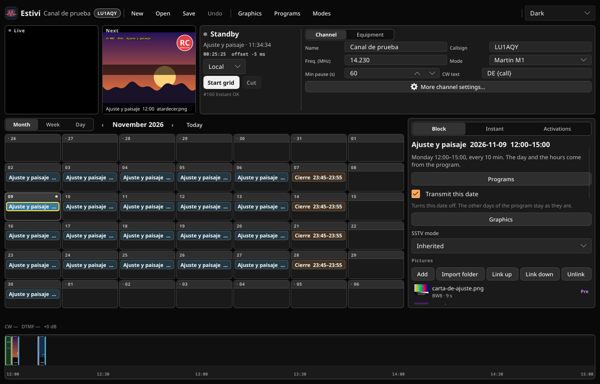
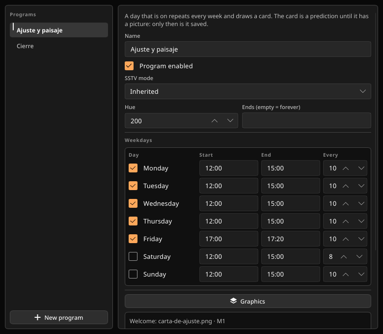
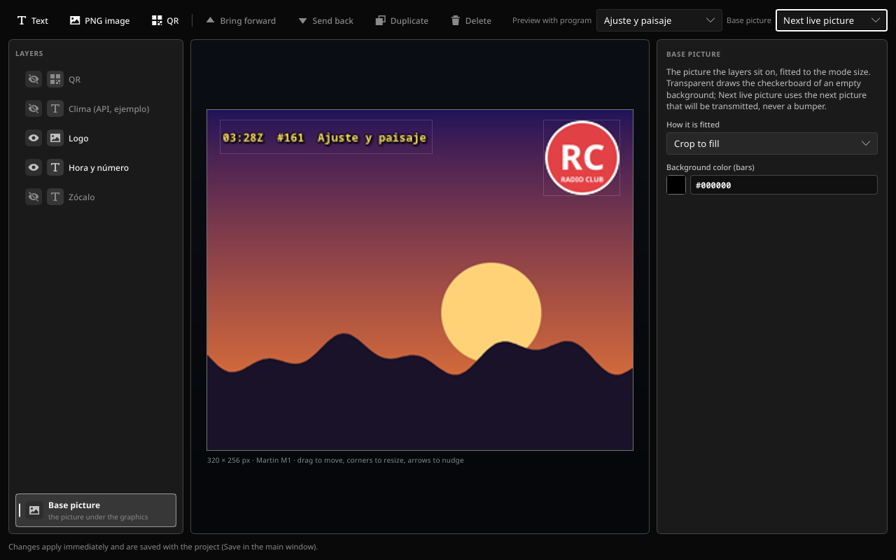

# Estivi

**English** · [Español](README_ES.md)

**SSTV, on a schedule.**

Estivi runs an SSTV channel the way a station runs a schedule. One window, no browser: programs that repeat every week, one-off blocks, pictures with bumpers, graphics, PTT, CW, AX.25, and a transmission log. Set the week, arm the grid, and the station runs itself.

<p align="center">
  
</p>

<p align="center"><em>The grid, the next transmission, and the selected block's timeline.</em></p>

`Version 0.2.2` · project format 2 · Linux, Windows, macOS · Rust + Slint

## What it does

- **Programs that repeat.** Every weekday gets its own start, end, and interval. Monday can be 15 minutes; Saturday can be hours. Set it once and forget it.
- **Blocks for everything else.** One date, one card. A special event, a net, a contest. Move it, skip it for a day, or delete it.
- **Pictures with a cast.** Pre- and post-bumpers travel with their picture. Welcome and bye go out on the first and last turn. Each picture can inherit its mode or override it.
- **Live and Next.** Watch the picture fill line by line while it goes out, and see what is coming next with its clock and file name.
- **Instant.** Send one picture outside the grid, with its own bumpers, mode, and graphics level.
- **It answers the radio.** CW and DTMF activations run a picture, a command, an API reply, or a sequence of actions.
- **Graphics without another tool.** Text, image, and QR layers per channel, program, or block, over the next live picture, a checkerboard, color bars, a grid, or a gray ramp.
- **Small and portable.** One executable, software renderer, seven themes, English or Spanish.

## A closer look

<p align="center">
  
</p>

<p align="center"><em>Programs: each weekday keeps its own start, end, and interval; turning one on copies the last schedule.</em></p>

<p align="center">
  
</p>

<p align="center"><em>Graphics: channel, program, and block layers stand on the next live picture.</em></p>

## Get it

Download the [latest release](https://github.com/fluoroom/estivi-tx/releases/latest):

- **Linux** x86_64
- **Windows** x86_64 and i686
- **macOS** universal (Apple Silicon + Intel), in `Estivi.app`

Extract it, run `estivi`, and open [`ejemplo/canal-demo.estivi`](ejemplo/canal-demo.estivi) to see a full channel: two programs, stored blocks, activations, a lower third, a QR, and a hidden weather layer. Every picture it uses is inside `ejemplo/`, so the sample runs anywhere.

## Build

Stable Rust 1.85 or newer.

```sh
cargo build --release
# target/release/estivi  (estivi.exe on Windows)
```

- **Linux**: ALSA, fontconfig, and GTK 3 (`libasound2-dev libfontconfig1-dev libgtk-3-dev` on Debian or Ubuntu).
- **macOS**: Xcode command line tools (`xcode-select --install`).
- **Windows**: MSVC toolchain. Release builds do not open a console.

Pushing a tag such as `v0.2.2` builds Linux x86_64, Windows x86_64 and i686, and a macOS universal app in CI, then attaches the archives and checksums to the GitHub release. The tag must match the workspace version in `Cargo.toml`.

## Under the hood

SSTV modes: Martin M1–M4, Scottie S1/S2/DX, Robot 24/36/72, Robot 12 color, Robot B/W 8/12/24, PD 50–290, and YoniQ. Every piece carries VIS.

AX.25 at 1200 baud and CW for ID. Export is FLAC in five shapes. Audio at 11025, 22050, 44100, or 48000 Hz. The UI draws in software (about 50 MB of RAM, no GPU driver).

The details — the order of a turn, every window behavior, the two files, import and export, modes, and verification — are in the **[manual](docs/MANUAL.md)**. AX.25 clients can read [AX25.md](AX25.md).

## Licenses

The bundled Noto fonts (`crates/core/assets/fonts`) are SIL Open Font License 1.1 (`OFL.txt`). Slint can be used under GPLv3 or under its royalty-free desktop license, which requires showing the “Made with Slint” attribution. FLAC is written with `flacenc` (Apache-2.0). QR codes use the `qrcode` crate.
