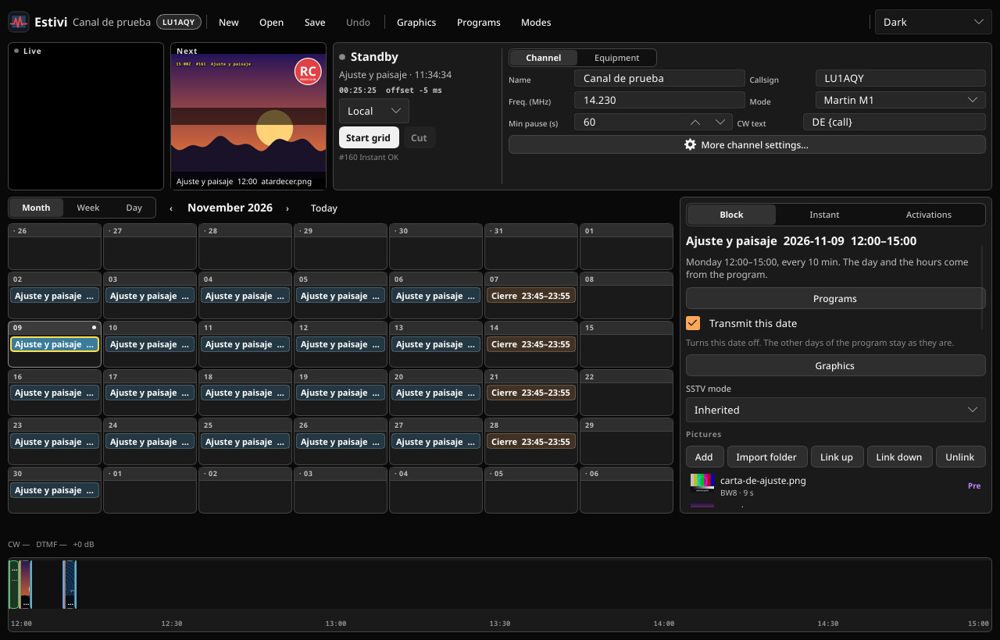
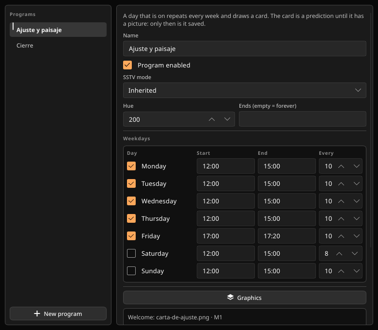
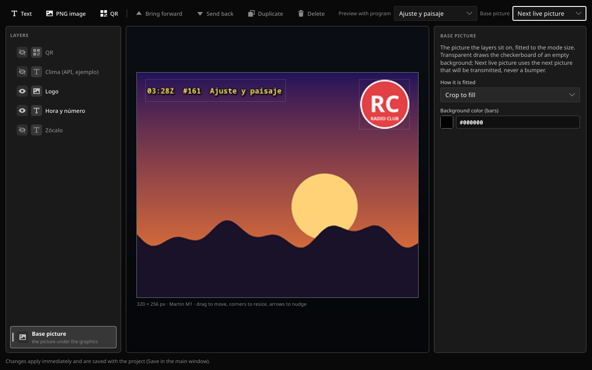

# Estivi

[English](README.md) · **Español**

**SSTV, con agenda.**

Estivi corre un canal de SSTV como una estación lleva su agenda. Una ventana, sin navegador: programas que se repiten cada semana, bloques de una sola fecha, imágenes con cortinas, gráficos, PTT, CW, AX.25 y un registro de transmisiones. Armá la semana, activá la grilla y la estación transmite sola.

<p align="center">
  
</p>

<p align="center"><em>La grilla, la próxima transmisión y la línea de tiempo del bloque seleccionado.</em></p>

`Versión 0.2.2` · formato de proyecto 2 · Linux, Windows, macOS · Rust + Slint

## Qué hace

- **Programas que se repiten.** Cada día de la semana tiene su propio inicio, fin e intervalo. El lunes pueden ser 15 minutos; el sábado, horas. Se arma una vez y listo.
- **Bloques para lo demás.** Una fecha, una tarjeta. Un evento especial, una ronda, un concurso. Movelo, salteá ese día o borralo.
- **Imágenes con cortinas.** Las cortinas previas y posteriores viajan con su imagen. La bienvenida y la despedida salen en el primer y último turno. Cada imagen puede heredar su modo o elegir otro.
- **En vivo y Siguiente.** Mirá la imagen llenarse línea por línea mientras sale al aire, y qué viene después con su hora y nombre de archivo.
- **Instantánea.** Mandá una imagen fuera de la grilla, con sus propias cortinas, modo y nivel de gráficos.
- **Le contesta a la radio.** Las activaciones por CW y DTMF ejecutan una imagen, un comando, una respuesta de API o una secuencia de acciones.
- **Gráficos sin otra herramienta.** Capas de texto, imagen y QR por canal, programa o bloque, sobre la próxima imagen al aire, un tablero de transparencia, barras de color, una grilla o una rampa de grises.
- **Compacto y portable.** Un solo ejecutable, renderizado por software, siete temas, inglés o español.

## Un vistazo

<p align="center">
  
</p>

<p align="center"><em>Programas: cada día de la semana mantiene su inicio, fin e intervalo; al activar un día se copia el último horario.</em></p>

<p align="center">
  
</p>

<p align="center"><em>Gráficos: las capas de canal, programa y bloque se apoyan sobre la próxima imagen al aire.</em></p>

## Descargalo

Descargá la [última versión](https://github.com/fluoroom/estivi-tx/releases/latest):

- **Linux** x86_64
- **Windows** x86_64 e i686
- **macOS** universal (Apple Silicon + Intel), dentro de `Estivi.app`

Descomprimilo, ejecutá `estivi` y abrí [`ejemplo/canal-demo.estivi`](ejemplo/canal-demo.estivi) para ver un canal completo: dos programas, bloques guardados, activaciones, un zócalo, un QR y una capa de clima oculta. Todas las imágenes que usa están dentro de `ejemplo/`, así que la muestra corre en cualquier máquina.

## Escuchar

La otra mitad es el receptor: abrí **[estivi-rx.lu1aqy.radio](https://estivi-rx.lu1aqy.radio)**, permití el micrófono y apuntalo al parlante de tu receptor. La decodificación ocurre en la página; el servidor solo sirve archivos estáticos.

## Compilar

Rust estable 1.85 o superior.

```sh
cargo build --release
# target/release/estivi  (estivi.exe en Windows)
```

- **Linux**: ALSA, fontconfig y GTK 3 (`libasound2-dev libfontconfig1-dev libgtk-3-dev` en Debian o Ubuntu).
- **macOS**: herramientas de línea de comandos de Xcode (`xcode-select --install`).
- **Windows**: toolchain MSVC. Las compilaciones de release no abren consola.

Al publicar un tag como `v0.2.2` compila en CI para Linux x86_64, Windows x86_64 e i686, y macOS universal; después adjunta los paquetes y sus checksums al release de GitHub. El tag tiene que coincidir con la versión del workspace en `Cargo.toml`.

## Bajo el capó

Modos SSTV: Martin M1–M4, Scottie S1/S2/DX, Robot 24/36/72, Robot 12 color, Robot B/W 8/12/24, PD 50–290 y YoniQ. Cada pieza lleva VIS.

AX.25 a 1200 baudios y CW para la identificación. Exporta FLAC en cinco formas. Audio a 11025, 22050, 44100 o 48000 Hz. La interfaz se dibuja por software (unos 50 MB de RAM, sin driver de GPU).

Los detalles —el orden de un turno, cada comportamiento de la ventana, los dos archivos, importación y exportación, los modos y la verificación— están en el **[manual](docs/MANUAL.md)** (en inglés). Quien escriba un cliente AX.25 puede leer [AX25.md](AX25.md).

## Licencias

Las fuentes Noto incluidas (`crates/core/assets/fonts`) son SIL Open Font License 1.1 (`OFL.txt`). Slint se puede usar bajo GPLv3 o bajo su licencia de escritorio libre de regalías, que pide mostrar la atribución “Made with Slint”. El FLAC se escribe con `flacenc` (Apache-2.0). Los códigos QR usan el crate `qrcode`.
