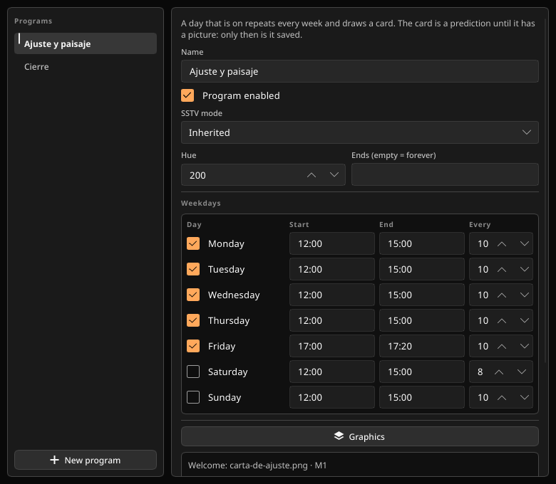
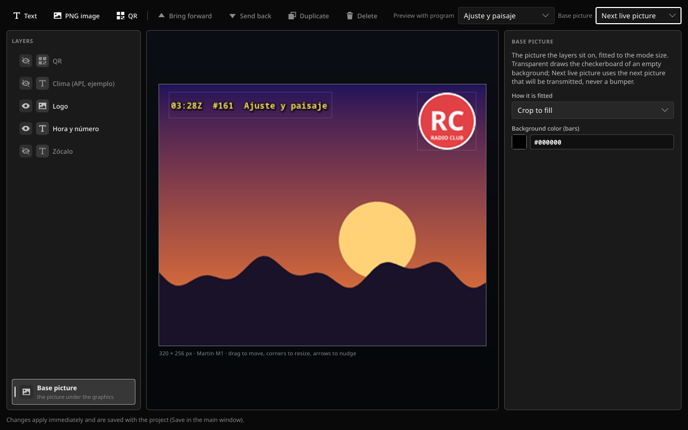

# Estivi manual

The long version: what a turn contains, how the window behaves, the two files, import and export, the SSTV modes, building, and what has been verified.

The short version is the [README](../README.md).

## Contents

- [What a transmission contains](#what-a-transmission-contains)
- [The window](#the-window)
- [Two files](#two-files)
- [Updates](#updates)
- [Import and export](#import-and-export)
- [SSTV modes](#sstv-modes)
- [Build](#build)
- [Verification](#verification)

## What a transmission contains

A turn that fits entirely before the next start and before the block end goes out. One that does not fit is skipped, and so are pictures past the number of turns. The block end releases the PTT and cuts the audio together, just before the written end. The offset moves the starts and leaves that end where you wrote it. The silence after the last start of a block does not have to satisfy the minimum pause. More than 90 seconds late, the turn is skipped.

Order of one grid turn, each piece only when it is enabled and has something to send:

1. VOX burst, if the project option is on (800 ms, in front of every transmitting action, not a row you can reorder).
2. Channel CW preamble.
3. AX.25 info frame.
4. Welcome, only on the first turn of a program block. If that turn is dropped, the welcome is dropped with it.
5. Pre-bumpers, then the picture, then post-bumpers. Each SSTV piece has its VIS in front. A mode AX.25 frame can sit in front of each one (`ESTIVI MODE R36`, `… BUMPER PRE`, `… WELCOME`, `… BYE`).
6. Bye, only on the last turn. If that turn is dropped, the bye is dropped with it.
7. AX.25 info again, then the channel CW postamble.

Bumpers do not consume a turn. A disabled picture is skipped and does not consume one either. A single turn that is both first and last carries the welcome and the bye.

There is no FSK ID. The digital identification is AX.25 and, if you leave it on, CW. AX.25 is always 1200 baud (1200/2200 Hz). The source call is the station callsign (`CALL-N` sets the SSID). `AX25.md` is the text a client reads in those frames.

## The window

The grid is the center: month, week, or day, with Today and the period kept to the left of that row. You can move back as far as you want and forward three years from today. A program card takes its color from the program hue. A common block is a neutral gray. A disabled program or a disabled block is a lighter gray and does not keep the hue. A filled, enabled card is opaque; a disabled one is dimmer; an empty one is the lightest and still occupies the hour, so nothing else can overlap it. The selected card has a yellow border. Clicking empty grid clears the selection and hides the timeline. Touching edges (one ends when the next starts) is not an overlap. If a drag, an edit, or a new card would cross another, none of the change is applied and the message names the card in the way.

Programs are a separate window. A new program has no days and no hours until you set them there: each weekday can be on or off, and each day has its own start, end, and interval. The grid draws a card from that schedule. The card does not store the day or the hours, and its panel does not edit them. An empty card is a prediction until it has a picture, its own graphics, or its own SSTV mode. Double-click an empty hour to create a common block on that date only. Nothing is created until you confirm. The dialog starts the interval at 6 minutes and proposes an end one interval after the click; you can lengthen the end, and changing the interval rewrites that proposal from the start. Dragging a common card changes only that card. Dragging a program card does not change the hours. A common block can be deleted. A program is deleted only after you choose what happens to its blocks: drop them, keep the ones with pictures as common blocks, or also keep the empty days up to a date you pick (three years at most). Turning a weekday off asks the same question for that day's future blocks. Past blocks stay.

<p align="center">
  
</p>

<p align="center"><em>Programs: each weekday keeps its own start, end, and interval; turning one on copies the last schedule.</em></p>

“Transmit this date” turns that occurrence off. On a program card the other days stay as they are. On a common block the card stays on the grid, in gray. Start grid and Stop grid arm and disarm the schedule. Cut aborts the transmission that is on the air. Undo puts the channel back to the last load or save and does not write the file.

Channel and Equipment live in the free right side of the top card, as two tabs with the fields used every day. More channel settings and More equipment settings open the full configuration in a card over the window; nothing scrolls. They are not sidebar tabs; the sidebar keeps Block, Instant and Activations.

The block panel lists only the pictures, in one flat list with the bumper links. A disabled picture stays in the list, dimmed, so it can be turned back on. Each row shows a small thumbnail, the file name, the mode, and the duration; a pre- or post-bumper carries its tag. At the bottom, under the configuration, the timing of the selected transmission (otherwise the first one) is calculated: the start clock, VOX, CW, AX.25, the welcome, each pre-bumper, VIS, the picture, each post-bumper, the bye, PTT lead and tail, the silence until the next start, and the total with the end clock. A transmission that does not fit is marked, and those rows are dim. Click a row to select it; the picture-mode menu follows that picture. Link up, link down, and unlink keep the bumper invariant: pre-bumpers sit immediately above their picture, post-bumpers immediately below, and a bumper does not point at a bumper. Dragging a row, or the up and down buttons, moves a whole group together and moves a bumper only within its own side. The timeline under the grid draws each transmission as its pieces, not one opaque box: VOX, CW, AX.25, the mode frame, VIS, a welcome or bye, each bumper, and the picture have their own color, label, and duration. It marks the start, the end, and the interval. A yellow playhead appears when now is inside the block. Clicking a piece selects that picture.

Live shows the picture that is going out, filling from the top as the audio plays. VIS, CW, and the other non-picture pieces stay black. Next is the soonest transmission that has not started, with its name, the clock time, and the file name. It redraws when that transmission changes, or when the block, program, or channel graphics that paint on it change. It does not stay on a block that is already on the air, and it does not stay on a block that a time edit pushed behind another.

Marking a bumper picks the mode from the file: Robot 12 color when some pixel has a channel difference above 8, Robot 8 black and white otherwise. An unreadable file stays Robot 12. You can change the mode afterwards. Unlinking leaves the mode and makes the row a normal picture.

Instant transmission has its own tab. It works while the grid is armed and idle. While something holds the PTT the transmit control is disabled and says why. It is not cut by a block end. Transmit stays at the top of the tab while the rest scrolls. The tab shows the picture with a thumbnail, its mode, CW and AX.25, and a graphics level: none, channel only, program + channel, or block + program + channel. Edit graphics opens the editor for that level. Starting from a picture of the selected block carries that picture's first pre- and post-bumpers and, when it is the first or last enabled picture, the welcome or the bye. Every bumper, welcome and bye can be included or turned off, changed, cleared, and given its own mode.

Activations have their own tab. They are not objects on the grid. A trigger is CW or DTMF, and any one match runs the activation. The tab edits the activation in place: its name, its trigger, and one card per action with the fields that action needs; the add menu appends an action. Actions run in order while that activation holds the PTT: CW, AX.25, DTMF, a local command, a picture, a random picture from a pool, pause, resume, or an API answer. Pause and resume do not key the radio and do not cut a transmission already on the air. A second match while that activation is queued or running does not enqueue another copy.

Graphics are edited per level. The block is painted first, then the program, then the channel, each on the frame the previous step left. A later step does not refill the background. The base picture menu stands the layers on a Photoshop-style transparency checkerboard (the default), on the next picture that will go out, on color bars, a grid, or a gray ramp. The next picture follows the turn slots, so an ongoing block moves on to its next picture; bumpers never count. When nothing is scheduled ahead for that level, the editor falls back to the first normal picture the level still has. Text, image, and QR layers sit on that frame. A QR can be text (with the same `{fields}`), a command, or an API. If the QR cannot be built, that layer is skipped and the rest of the frame goes out. Fields, also valid in text: `{block}`, `{range}`, `{days}`, `{daysleft}`, `{next}`.

<p align="center">
  
</p>

<p align="center"><em>Graphics: channel, program, and block layers stand on the next live picture, a checkerboard, color bars, a grid, or a gray ramp.</em></p>

The themes are Dark (the default; a saved Gray theme opens as Dark), Light, Dracula, Lavender, Pastel, Subte, and Subte light. Block hues stay their own colors. The interface is English or Spanish, and the first launch follows the system language when it is one of those two. Errors, warnings, and other system text stay in English.

## Two files

| File | What it stores | Where |
|---|---|---|
| `estivi.toml` | This computer: audio, serial port, PTT, CAT, language, theme, the update check, and the NTP offset | Next to the executable when that folder is writable, otherwise `~/.config/estivi/` or `%APPDATA%\estivi\` |
| `*.estivi` | The channel, format 2 | Wherever you save it. Pictures inside the project folder are stored with a relative path |
| `*-registro.csv` | One line per transmission. The last columns are the block id, the program id, and whether the block end cut the audio (`cortado` is `0` or `1`) | Next to the project |

An old format 1 file is rejected with a clear error and is not rewritten. There is no converter. Format 2 is the file.

The clock of the operating system is not changed. On the first launch Estivi offers to follow `pool.ntp.org` and store the offset (every 6 hours, editable under Equipment). If you refuse, it does not ask again. If the server fails later, the last offset is kept and transmission is not blocked. The grid, the PTT cutoff, “now” for a folder import, and an export range all use the system clock plus that offset. Under Equipment, the audio output, audio input, and serial port are picked from the devices the system reports, not typed; Refresh re-reads the lists. On Linux the audio lists keep the ALSA cards and PipeWire, with one plug PCM per card; PulseAudio and the ALSA plugin PCMs are hidden. A configured device that is no longer connected stays visible and selected, so opening the panel does not silently change the setup.

`.ttf` / `.otf` fonts in a `fuentes/` folder next to the project or the executable show up in the graphics editor, besides the bundled Noto fonts.

## Updates

At most once a day, including at startup, Estivi asks the public GitHub release page for `fluoroom/estivi-tx` whether there is a newer version. Nothing about the station is sent: it is one HTTPS request, and the only trace it leaves is the time of the check in `estivi.toml`. A new version puts an Update button in the top bar and, when nothing is transmitting, opens a notice; Later silences that version until a newer one appears. Check now under Equipment ignores the daily interval.

Downloading installs the archive for this system, not a script: Linux x86_64, Windows x86_64 or i686, or the universal `Estivi.app` on macOS. The archive must match the `SHA256SUMS.txt` attached to the same release; a release without that file is not installed. Linux and Windows replace only the executable, so `ejemplo/`, `fuentes/`, and anything else in the folder stay untouched. macOS replaces the whole signed app bundle.

Estivi never restarts in the middle of a transmission: installing waits until nothing holds the PTT. If the folder that holds the copy is not writable — a package-managed `/usr/bin`, or a macOS app launched from a read-only location — the window offers the release page and does not try to replace anything. Updates are on by default; the automatic check can be turned off under Equipment.

## Import and export

Import is a button, not a drop. A folder named `block` plus a number (`block01`, `block1`, `BLOCK02`, case does not matter) fills the Nth upcoming occurrence of the selected program, counting empty days. `block02` alone fills the second and leaves the first alone. Inside the folder the order is natural (`2` before `10`). A number past the remaining days is reported and skipped. The folder does not create new days. A file whose name ends in `-bp` before the extension is the post-bumper of the previous picture; `-bn` is the pre-bumper of the next. `foto-bp-2.png` is not a bumper. A `-bp` with nothing before it, or a `-bn` with nothing after it, is added as a normal picture and reported.

Export is not saving the project. You pick a range and one of five shapes: one file, each transmission and each silence, each piece, slices of N seconds, or one file per block. The files add up to the range. The time in the name is when to press play, in the channel timezone (`-0300` or `Z`). The index comes first so alphabetical order is play order. The encoder in this build is FLAC. MP3 is not included because the usual encoder is LGPL and linking it here does not match the license of the program. AAC is not included because there is no encoder that ships without an external tool. Sample rates are 11025, 22050, 44100, and 48000. The audio is synthesized at the rate you pick. Leaving FLAC at 44100 shows a warning every time: any other setting introduces slight visual changes in the decoded image. It does not guarantee a perfect transmission, but it is still usable.

## SSTV modes

Martin M1–M4, Scottie S1, S2 and DX, Robot 24, 36 and 72, Robot 12 color, Robot B/W 8, 12 and 24, PD 50, 90, 120, 160, 180, 240 and 290, and YoniQ. Every SSTV piece carries VIS. Scottie keeps its 9 ms sync glued to the VIS. YoniQ is the analog picture mode (320×256, about 70 s).

The mode of a picture is its own, otherwise the block's, otherwise the program's, otherwise the channel's. The picture, block, and program menus start with Inherited. The welcome and the bye use their own mode, otherwise the program's, otherwise the channel's. They do not take the block's mode.

## Build

Stable Rust 1.85 or newer.

```sh
cargo build --release
# target/release/estivi  (estivi.exe on Windows)
```

- **Linux**: ALSA, fontconfig, and GTK 3 (`alsa-lib`, `fontconfig`, and `gtk3` on Arch; `libasound2-dev`, `libfontconfig1-dev`, and `libgtk-3-dev` on Debian or Ubuntu).
- **Windows**: build on Windows with the MSVC toolchain. Release builds do not open a console.
- **macOS**: build on macOS with the Xcode command line tools (`xcode-select --install`). The release archive wraps the universal binary in `Estivi.app`.
- The UI draws in software (about 50 MB of RAM, no GPU driver). Equipment can switch the renderer only by the setting that was already in the config (`gpu_render`); the default stays the CPU renderer.

Pushing a tag such as `v0.2.3` runs the release workflow. The tag must match the workspace version in `Cargo.toml`; it builds Linux x86_64, Windows x86_64 and i686, and a macOS universal app, then attaches the archives and their checksums to the GitHub release.

```sh
cargo run -p estivi-core --example render -- ejemplo/canal-demo.estivi cuadro.png [audio.wav] [programa] [modo]
cargo run -p estivi-core --example dispositivos
```

`ejemplo/canal-demo.estivi` is a format 2 channel (callsign `LU1AQY`) with two programs, stored blocks, two activations, a lower third, a QR, and a hidden weather layer. Every picture it names is inside `ejemplo/`, so the sample runs on any machine.

## Verification

`cargo test -p estivi-core --lib`: line timings, VIS, pixel edges, Martin M1 round-trip, CW and DTMF (including a DTMF tone round-trip), the calendar (turns, overlap, days left, the three-year limit, DST), AX.25 frames, the ALSA/PipeWire device filter, bumper linking and `block02` import, export durations for the five shapes, one short FLAC file, and the updater's release/asset selection, checksum parsing, and archive payload extraction.

`cargo test -p estivi`: preview fitting keeps the aspect ratio inside its box, and the Live reveal blacks only the rows that have not been scanned.

Decoded with QSSTV 9 over real audio, except where noted:

| Mode | Result |
|---|---|
| Martin M1 | OK, transmitted live from the app |
| Martin M2 · Scottie S1, S2, DX | OK |
| Robot 24, 36, 72 · Robot B/W 8, 12 | OK |
| PD 50, 120, 290 | OK |
| PD 90, 160, 180, 240 | Same code as the tested PD modes; not decoded separately |
| Martin M3, M4 · Robot B/W 24 | QSSTV does not support them; they follow the slowrx table and are still untested on the air |
| Robot 12 color | Duration is tested (12.0 s of picture after the VIS). QSSTV and slowrx do not transmit it; slowrx only has Robot 12 black and white, so this mode was not decoded there |
| YoniQ | Analog mode from MMSSTV 1.13.2: 320×256, 69.837 s of picture, VIS `0x73` with odd parity. Not decoded with QSSTV |

The color range default is full range, which is what QSSTV decodes as a normal picture. Studio range remains an option and comes out washed on QSSTV.

Serial PTT and CAT (`rigctld`) are implemented and have not been tried on a radio. RTS and DTR are chosen apart: off, positive (high while keyed), or negative (high at rest). On Linux, the `front` PCM of some cards goes through a software mixer: if the level is very low, pick the `plughw` device or raise that control.

The window was exercised headlessly against `ejemplo/canal-demo.estivi`: a card selected from the grid, the flat picture list with thumbnails, the timing breakdown, the per-piece timeline, a picture copied into the instant tab with its bumper toggles and graphics levels, the graphics editor opened from that tab, and the audio and serial device lists. The editor canvas was checked at its normal size and at the 1000×640 minimum, and a temporary future block with a picture exercised the Next preview. Creating a program in its window, rejecting an overlap, exporting a FLAC, and a real transmission were not exercised in that run.
